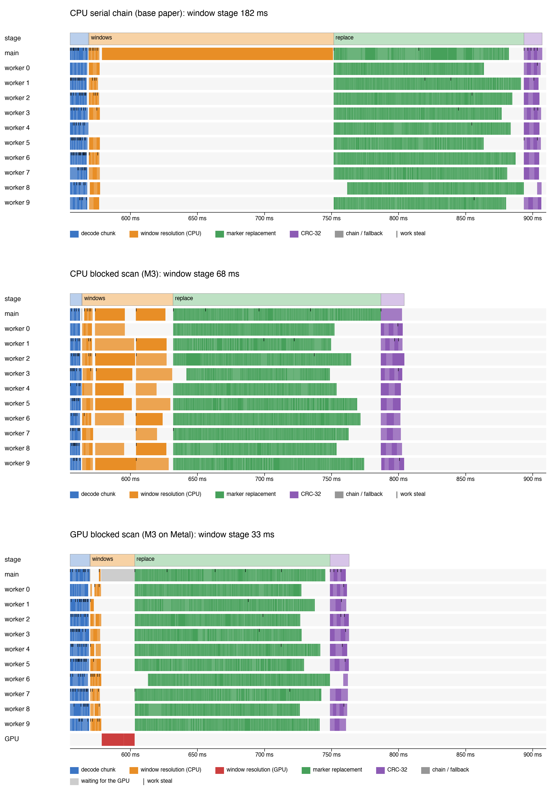

# Riptide: Breaking the Serial Window Chain in Parallel Gzip Decompression

Course project for **IT 301 Parallel Computing**, Department of Information Technology, NIT Karnataka, Surathkal.

| Member | Roll no. |
|---|---|
| Devansh Hiren Shah | 241IT024 |
| Mantri Samarth Prakash | 241IT043 |
| Shubh Minesh Thakkar | 241IT076 |
| Ritesh Bhagat | 241IT063 |

Riptide decompresses ordinary, unmodified `.gz` files on all cores of a machine and produces output byte-identical to zlib. It is written from scratch in C++20 and Objective-C++: a table-driven DEFLATE decoder, a speculative block finder, a work-stealing thread pool, three parallel prefix scans, GPU window resolution with Metal, parallel CRC-32, a timeline tracer, and the pipeline that connects them.

## The problem

DEFLATE, the format inside gzip, has two dependencies that make decompression serial: blocks are not byte-aligned and have no index, and a back-reference may copy bytes from up to 32 KiB earlier in the output. Our base paper, **rapidgzip** (M. Knespel and H. Brunst, *HPDC '23*, [doi:10.1145/3588195.3592992](https://doi.org/10.1145/3588195.3592992)), decodes chunks in parallel by finding block starts speculatively and writing *markers* for bytes that belong to the unknown preceding window. It then resolves the windows one chunk after another, which it states cannot be parallelised.

## Our contributions

- **M3 (primary): window resolution by parallel prefix scan.** Each chunk's final window is a map from the window before it. These maps compose associatively, so the chain is a prefix scan. We implemented Hillis–Steele, Blelloch and a blocked scan (default), which shortens the longest chain of dependent compositions from N − 1 to about 2N/P + P.
- **M3 on the GPU.** Every step of window resolution is itself 32 768 independent lookups, so it also runs on the GPU: `--window gpu-blocked` performs the blocked scan with Metal on Apple silicon, writing the window maps straight into memory the GPU shares with the CPU.
- **M1: split-on-overflow.** A chunk that exceeds its output budget is split across idle workers instead of being finished on one thread. We also evaluated work-balanced chunking from Huffman-header estimates; it does not pay off (see below).
- **Timeline tracing.** `--trace run.json` records what every thread and the GPU do during a run, viewable in [Perfetto](https://ui.perfetto.dev) or drawn with `bench/plot_trace.py`.

Design details are in [docs/design.md](docs/design.md), including the concurrency and performance problems we had to fix along the way.



## Results

Apple M4 (4 performance + 6 efficiency cores), 10 threads, medians of 10 interleaved runs. Full tables, IQRs and significance tests: [results/summary.md](results/summary.md); method: [docs/evaluation.md](docs/evaluation.md).

| File | Ratio | zlib | Riptide, 10 threads | vs zlib | vs 1 thread |
|---|---|---|---|---|---|
| Silesia tarball (212 MB) | 3.11 | 1.22 GB/s | 2.60 GB/s | 2.1× | 2.9× |
| Silesia × 5 (1.06 GB) | 3.11 | 1.22 GB/s | 3.01 GB/s | 2.5× | 3.3× |
| Mixed archive (444 MB) | 3.51 | 1.93 GB/s | 2.84 GB/s | 1.5× | 2.5× |
| FASTQ reads (1.08 GB) | 4.11 | 1.64 GB/s | 1.98 GB/s | 1.2× | 2.7× |
| JSON logs (1.08 GB) | 23.1 | 6.04 GB/s | 3.75 GB/s | 0.6× | 2.4× |

- **Correctness:** all 1600 timed runs are byte-identical to zlib.
- **M3:** the scan resolves windows 2.9–3.9× faster than the serial chain at every chunk size (p < 0.001). With 64 KiB chunks the serial chain is about a fifth of the run, and the scan makes the whole decompression 1.14× (Silesia × 5) to 1.21× (Silesia) faster. With chunks of 1 MiB and more the chain is under 2% of the run and the difference is not measurable.
- **M3 on the GPU:** on the M4's GPU (Metal) the window step for 5 205 chunks takes 26 ms, against 66 ms with the CPU scan and 184 ms as a serial chain (2.5× and 7.0×, p < 0.001); the whole run is 1.06× faster than with the CPU scan. From 1 MiB chunks up the GPU's fixed launch cost of about 1 ms makes it no faster.
- **Why small chunks matter:** 512 KiB chunks use 19–35% less peak memory than 4 MiB chunks; M3 removes most of the window-chain cost that small chunks bring.
- **M1:** with a tight output budget and few chunks per thread, splitting cuts load imbalance λ from 5.6 to 1.3 and time from 407 ms to 256 ms (1.59×). With many chunks per thread it makes no significant difference.
- **Negative result:** work-balanced chunking costs 10–74 ms of sampling and does not speed up decoding.
- **Where Riptide loses:** on the highly compressible logs, zlib's work is mostly long memory copies, while Riptide must replace markers in 94% of the output.

### Against rapidgzip (the base paper's software)

rapidgzip 0.16.0 and `riptide`, both as command-line tools in test mode on the same machine, start-up time subtracted (`bench/compare_rapidgzip.py`):

| File | riptide, 10 threads | rapidgzip, 10 threads | riptide, 1 thread | rapidgzip, 1 thread |
|---|---|---|---|---|
| Silesia | 2.33 GB/s | 2.14 GB/s | 0.87 GB/s | 0.47 GB/s |
| Silesia × 5 | 2.50 GB/s | 2.16 GB/s | 0.86 GB/s | 0.46 GB/s |
| FASTQ | 1.99 GB/s | 2.03 GB/s | 0.66 GB/s | 0.54 GB/s |
| Logs | 4.21 GB/s | 4.61 GB/s | 1.75 GB/s | 1.78 GB/s |

- With 10 threads the two are statistically indistinguishable on every file (0.91–1.16×). With one or two threads riptide is 1.2–1.9× faster, partly because rapidgzip's ARM build does not use ISA-L, which it uses on x86.
- rapidgzip needs 2–5× less memory, because it streams its output; riptide holds the whole output.
- rapidgzip handles small chunks better: at 64 KiB it is 1.3× faster than riptide even with the prefix scan. So the scan's 1.11–1.19× gain inside riptide does not show that rapidgzip's own window chain is a bottleneck; testing that requires implementing M3 inside rapidgzip.

## Building and running

Requires CMake ≥ 3.20, a C++20 compiler and zlib (used only by the tests and the benchmark); the GPU code additionally needs Xcode's command-line tools on macOS (the Metal kernels are compiled at run time).

```bash
cmake -S . -B build -DCMAKE_BUILD_TYPE=Release
cmake --build build -j
ctest --test-dir build
```

Decompress a file (writes to standard output by default):

```bash
build/riptide -v -o output.tar input.tar.gz
```

Useful options: `-P N` threads, `--chunk-size 512K`, `--window serial|hillis-steele|blelloch|blocked|gpu-serial|gpu-blocked`, `--overflow serial|split`, `--chunking fixed|work-balanced`, `--sequential`, `--json` (per-stage statistics), `--trace run.json` (timeline of every thread), `--repeat N`. `build/riptide --help` lists all of them.

The GPU strategies need Apple silicon; on other systems, or with `-DRIPTIDE_GPU=OFF`, the build uses a stub and they report that no GPU is available.

Sanitizer builds: `-DRIPTIDE_SANITIZE=ON` (AddressSanitizer and UndefinedBehaviorSanitizer) or `-DRIPTIDE_SANITIZE_THREAD=ON` (ThreadSanitizer); the test suite runs clean under both.

## Reproducing the evaluation

```bash
./scripts/get_silesia.sh                           # downloads Silesia (68 MB)
python3 bench/datasets.py ~/riptide-data           # builds the five datasets (needs NumPy)
bench/run_benchmarks.sh build ~/riptide-data results 10
python3 bench/compare_rapidgzip.py build/riptide "$(which rapidgzip)" ~/riptide-data results 10   # needs pip install rapidgzip==0.16.0
python3 bench/analyze.py results                   # writes results/summary.{md,json}
```

The suite takes about 20 minutes on the machine above.

## Live demo

```bash
bench/demo.sh build ~/riptide-data                 # Enter runs a step, s skips it; NOPAUSE=1 runs straight through
STEPS="2 6 8 13" bench/demo.sh build ~/riptide-data   # only some steps; REPS=5 for more runs per number
```

Each step measures its numbers live (median of `REPS` runs, default 3) with `bench/demo_stats.py` and prints them next to the report's: gzip against riptide and the SHA-256 of both outputs on Silesia and Silesia × 5, the six stages, scaling on 1 to 10 threads, every window strategy at 64 KiB chunks and serial, blocked and GPU blocked across chunk sizes (M3), serial against split overflow on the logs file (M1), peak memory, rapidgzip if it is installed, the pipeline visualizer and the tests. The last step prints every number on one screen. Step 11 opens `bench/pipeline_viz.py`'s page in the browser: the run replayed from its trace in slow motion, with the six stages, the state of every chunk and every thread's tasks, for 4 MiB chunks and for 64 KiB chunks with the serial, blocked and GPU window step. A full run takes about five minutes. Plug in the charger and close other apps first: riptide holds the whole output in memory, so swapping or Low Power Mode makes it look no faster than gzip.

## Repository layout

```
src/riptide/
  common/      bit reader, DEFLATE tables, realloc-backed buffer, errors, stopwatch, tracer
  huffman/     canonical Huffman decoder with two-level lookup tables
  inflate/     chunk decoder (markers or known window), block finder, header estimator
  gzip/        gzip header and footer, CRC-32 (hardware and slice-by-8), CRC combination
  io/          memory-mapped input
  parallel/    work-stealing thread pool, task groups, parallel_for, prefix scans
  window/      window maps, composition, scan-based resolution (M3)
  gpu/         window resolution on the GPU with Metal (M3 on Apple silicon)
  pipeline/    partitioner (M1), parallel and sequential decompressors, statistics
tools/         riptide command-line tool and riptide_bench benchmark driver
tests/         49 unit and integration tests in 14 CTest suites
bench/         dataset generator, experiment runner, statistical analysis, timeline plots, live demo, its measurements and the pipeline visualizer
results/       raw CSVs and summary of the evaluation
scripts/       Silesia download (into data/, which git ignores)
docs/          design and evaluation notes, final report and presentation
```

## Branches

| Branch | Contents |
|---|---|
| `main` | Everything below, merged; the version to build and grade |
| `feature/core-inflate` | Bit reader, Huffman decoder, chunk decoder with markers, block finder, CRC-32, gzip format |
| `feature/parallel-runtime` | Work-stealing thread pool, task groups, `parallel_for`, prefix scans, timeline tracer |
| `feature/window-resolution` | Window maps, composition and scan-based resolution (M3) |
| `feature/parallel-pipeline` | Partitioner, overflow policies (M1), parallel and sequential decompressors |
| `feature/gpu-offload` | Window resolution on the GPU with Metal, and its use in the pipeline |
| `bench/experiments` | Dataset generator, experiment runner, statistical analysis, rapidgzip comparison |
| `docs/final-report` | Final report, presentation, design and evaluation notes |

Smaller pieces of work (bug fixes, performance changes, tests, prototypes) were developed on short-lived branches that have been merged and deleted; `git log --merges main` lists them with their original names.
